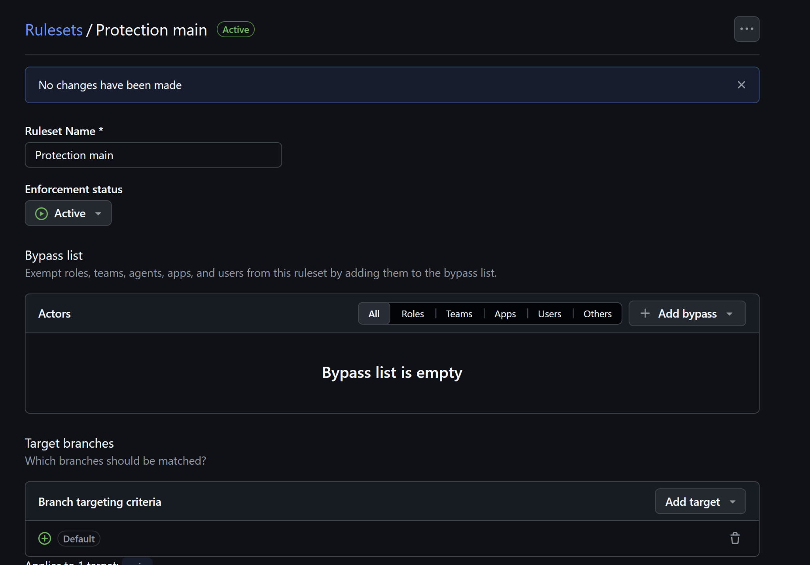
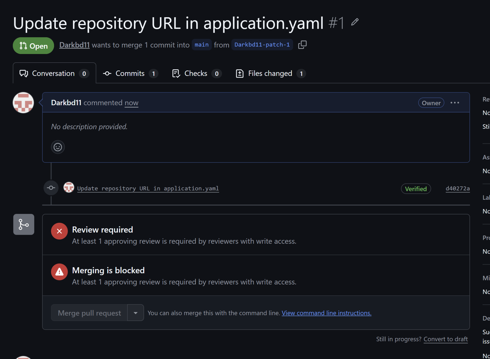
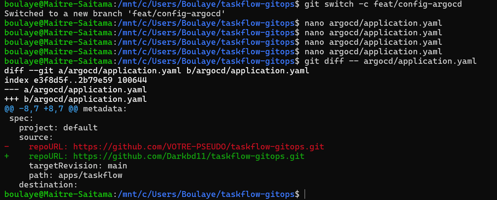
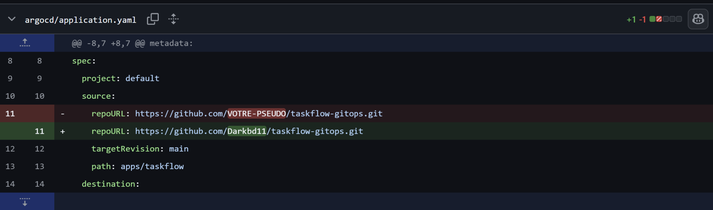
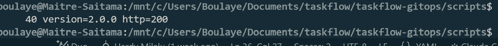
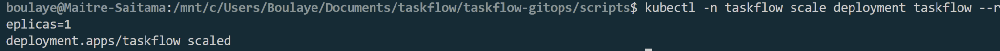

# taskflow-gitops — dépôt GitOps du cours CI/CD M2

Ce dépôt décrit **l'état voulu** de l'application TaskFlow dans Kubernetes.
Argo CD le surveille et aligne le cluster dessus : pour changer la production,
on ne tape pas de commande, on fait une **Pull Request**.

## Installation (à faire chez vous, avant le cours)

Prérequis : Docker Desktop démarré, 8 Go de RAM, 10 Go de disque libre.
Sous Windows : WSL2 (Ubuntu) + intégration WSL de Docker Desktop, et toutes les commandes dans WSL.

```bash
git clone https://github.com/9m7fjfpv9k-cyber/taskflow-gitops.git
cd taskflow-gitops
./scripts/install.sh
```

Le script crée un cluster local `kind`, installe Argo CD et Argo Rollouts,
puis télécharge les images des labs. Comptez 5 à 15 minutes.
Il peut être relancé sans risque.

## Structure

| Chemin | Rôle |
| --- | --- |
| `apps/taskflow/` | Les manifests surveillés par Argo CD |
| `argocd/application.yaml` | Déclare l'application dans Argo CD |
| `exemples/bluegreen/` | Manifests pour le déploiement Blue-Green |
| `exemples/canary/` | Manifests pour le déploiement Canary |
| `exemples/robustesse/` | Canary avec test de charge k6 automatique, modèle de postmortem |
| `exemples/ci/` | Pipelines de la mini-PSSI (GitHub Actions et GitLab CI) |
| `policies/` | Mini-PSSI et règles Rego vérifiées par conftest |
| `scripts/install.sh` | Installation de l'environnement |
| `scripts/argocd-ui.sh` | Ouvre l'interface d'Argo CD |
| `scripts/observe.sh` | Montre quelle version répond, et avec quel code HTTP |
| `scripts/charge.sh` | Lance à la main le test de charge k6 contre un service |

## Images disponibles

`ghcr.io/9m7fjfpv9k-cyber/taskflow` en versions `1.0.0`, `1.1.0`, `2.0.0`, `2.1.0` et `2.2.0`.

# TaskFlow - Lab GitOps du matin

**CI/CD M2 · Jour 2 · Sup de Vinci · 14 octobre 2026**  
**Binôme : Boulaye DOUCOURE (Darkbd11) et Darry KANYEP (Daryl-6)**

Ce README reprend le lab du matin de la slide 9. Le but était de déployer TaskFlow à partir de Git, de modifier volontairement le cluster pour créer un écart, puis de préparer un retour à la version précédente par Pull Request.

Le dépôt utilisé est [Darkbd11/taskflow-gitops](https://github.com/Darkbd11/taskflow-gitops). Les captures sont dans le dossier `docs/`, à côté de ce README.

## 1. Préparer le dépôt et protéger main

Nous avons travaillé sur un fork de `taskflow-gitops`, avec Daryl comme collaborateur pour relire les changements. J'ai activé un ruleset sur la branche par défaut, `main`, avec une approbation obligatoire avant la fusion d'une PR.

L'intérêt était de faire valider les modifications à deux avant qu'Argo CD les récupère. La liste de contournement du ruleset est vide.



La protection a bien bloqué la première PR tant qu'elle n'avait pas reçu de validation : GitHub affichait `Review required` et `Merging is blocked`.



Malgré son nom de fichier, cette capture montre la PR encore ouverte. La preuve de sa fusion se trouve à l'étape suivante.

## 2. Relier Argo CD à notre dépôt

L'environnement a été installé avec le script fourni dans le dépôt :

```bash
cd scripts
./install.sh
cd ..
```

Le script a créé le cluster kind `cicd` et installé Argo CD. Avant d'appliquer les fichiers, le contrôle demandé par le lab est :

```bash
kubectl config current-context
```

Le contexte attendu est `kind-cicd`. Cela permet de vérifier qu'on travaille sur le cluster du lab.

Dans `argocd/application.yaml`, j'ai remplacé `VOTRE-PSEUDO` par mon compte GitHub. Argo CD doit lire notre fork, sur la branche `main`, dans le dossier `apps/taskflow` :

```yaml
source:
  repoURL: https://github.com/Darkbd11/taskflow-gitops.git
  targetRevision: main
  path: apps/taskflow
```

La modification a d'abord été préparée en local sur la branche `feat/config-argocd` :



Voici le même changement dans GitHub :



La PR **#1**, `Update repository URL in application.yaml`, a été approuvée par Daryl puis fusionnée dans `main`. Le commit de fusion visible est `93623dc`.


Une fois le fichier à jour en local, la commande prévue pour déclarer l'application est :

```bash
kubectl apply -f argocd/application.yaml
```

Cette initialisation est à faire sur le cluster de chacun. Ensuite, Argo CD suit les manifests du dépôt.

## 3. Vérifier le premier déploiement en 1.0.0

Nous avons vérifié les pods dans le namespace `taskflow` :

```bash
kubectl get pods -n taskflow -w
```

La capture montre quatre pods en `Running`, chacun avec `1/1` conteneur prêt et aucun redémarrage.


Depuis la racine du dépôt, le script d'observation se lance avec :

```bash
./scripts/observe.sh
```

Dans la capture, je suis déjà dans `scripts`, donc j'utilise `./observe.sh`. Le résultat affiche `40 version=1.0.0 http=200` : les 40 réponses regroupées correspondent à la version `1.0.0`, avec un code HTTP 200.


Le lab demande aussi de vérifier **Synced** et **Healthy** dans Argo CD. `Synced` indique que le cluster correspond à Git ; `Healthy` indique que les ressources de l'application sont dans un état sain. Ce sont deux contrôles différents. La capture de ces statuts reste à ajouter : les pods et les réponses HTTP ne remplacent pas cette preuve.

## 4. Passer en 2.0.0 par Pull Request

J'ai modifié l'image dans `apps/taskflow/deployment.yaml`, sur la branche `feat/release-2.0.0`. Le changement porte sur le tag : `1.0.0` devient `2.0.0`.


J'ai ensuite ouvert la PR **#2**, `update image to 2.0.0`. Comme pour la configuration, GitHub demandait une approbation avant de permettre la fusion.


Après la fusion, Argo CD peut récupérer le nouvel état de `main` et mettre à jour le Deployment. Le script d'observation confirme que l'application sert bien la nouvelle version :

```text
40 version=2.0.0 http=200
```



**Délai de déploiement : à compléter.** Les captures confirment le passage en `2.0.0`, mais elles ne donnent pas l'heure exacte de la fusion et celle de la première réponse en `2.0.0`. Le nombre `40` représente les réponses regroupées, pas un délai de 40 secondes. Pour mesurer le délai demandé, il faut relever ces deux instants et calculer leur différence.

## 5. Provoquer une dérive sur le cluster

J'ai demandé directement au cluster de passer à un seul replica, sans modifier le fichier dans Git :

```bash
kubectl -n taskflow scale deployment taskflow --replicas=1
```

La commande a été acceptée :



On crée ainsi une dérive : le nombre de replicas demandé au cluster peut être différent de celui défini dans Git.

**Que doit faire Argo CD ?** Avec la synchronisation automatique et `selfHeal` activés, Argo CD détecte l'écart et réapplique le nombre de replicas défini dans Git. Kubernetes ajuste ensuite les pods. Le `scale` manuel ne change donc pas durablement la configuration voulue.

La capture prouve que le `scale` a été exécuté, mais elle ne montre pas le retour au nombre prévu. Ce retour reste à documenter avec un suivi des pods et du Deployment.

Le deuxième test demandé est une modification manuelle de l'image. Par exemple, lorsque Git demande encore `2.0.0`, on peut provoquer l'écart suivant :

```bash
kubectl -n taskflow set image deployment/taskflow \
  taskflow=ghcr.io/9m7fjfpv9k-cyber/taskflow:1.0.0
```

Avec `selfHeal`, le résultat attendu est le rétablissement de l'image `2.0.0` déclarée dans Git. Ce test n'apparaît pas dans les captures conservées ; son exécution et sa correction restent à documenter.

Pour observer ces deux tests :

```bash
kubectl -n taskflow get deployment taskflow -w
kubectl -n taskflow get pods -w
```

Ces commandes de modification directe servent ici à provoquer volontairement une dérive pour l'exercice.

## 6. Préparer le retour en 1.0.0 avec Revert

Pour revenir à la version précédente, j'ai utilisé le bouton **Revert** de la PR #2. GitHub a préparé une branche `revert-2-feat/release-2.0.0`, puis une nouvelle PR pour annuler le changement d'image.


La PR **#3**, `Revert "update image to 2.0.0"`, référence la PR #2. Elle est elle aussi soumise à la validation du binôme.


Daryl a laissé une approbation et le commentaire « approbation du revert vers la version 1 » :


Sur cette dernière capture, le lien vers la PR #3 affiche encore `Open`. Le bloc de fusion en bas concerne la branche `feat/release-2.0.0`. Cette image ne suffit donc pas à confirmer la fusion du revert.

Après fusion de la PR #3, le résultat attendu est que Git indique à nouveau `1.0.0` et qu'Argo CD applique ce retour arrière. Il reste à conserver la preuve de fusion de la PR #3 et une nouvelle sortie de `./scripts/observe.sh` montrant `version=1.0.0 http=200` après le revert.

## Journal des déploiements

Les étapes ci-dessous suivent l'ordre du lab du 14 octobre 2026. Les heures exactes n'ont pas été relevées dans les captures.

| Étape | Changement | Résultat conservé |
| --- | --- | --- |
| Configuration - PR #1 | Argo CD pointe vers notre fork | PR approuvée par Daryl et fusionnée, commit `93623dc` |
| Premier déploiement | TaskFlow en `1.0.0` | Quatre pods prêts ; `40 version=1.0.0 http=200` |
| Mise à jour - PR #2 | Image `1.0.0` vers `2.0.0` | `40 version=2.0.0 http=200` ; délai exact à compléter |
| Dérive sur les replicas | `kubectl scale` vers 1 replica | Commande acceptée ; correction automatique à documenter |
| Dérive sur l'image | Test `kubectl set image` demandé | Exécution et correction à documenter |
| Retour arrière - PR #3 | Revert de la PR #2 vers `1.0.0` | PR créée ; fusion et version finale à confirmer |

## Réponses aux trois questions

### Push ou pull ?

Le fonctionnement du lab est **pull**. Argo CD, qui tourne dans le cluster, lit le dépôt Git et applique l'état défini sur `main`. Nous proposons les changements par PR, puis Argo CD les récupère après leur fusion. Le `kubectl apply` initial sert à déclarer l'application ; les mises à jour suivantes passent par Git.

### Qui a corrigé quoi ?

Nous modifions la configuration dans Git et le binôme relit les PR. Argo CD compare ensuite cette configuration avec le cluster et réapplique les manifests lorsqu'il détecte un écart. Kubernetes se charge de créer, remplacer ou supprimer les pods pour respecter le Deployment.

Dans les tests de dérive, c'est donc Argo CD, avec `selfHeal`, qui doit rétablir le nombre de replicas ou l'image déclarés dans Git. La capture du `scale` montre la modification manuelle ; il reste à ajouter la preuve de sa correction.

### Pourquoi git revert ?

`git revert` crée un nouveau commit qui annule un changement sans effacer l'historique. Nous gardons la trace de la mise à jour, du retour arrière et de la relecture par le binôme.

Cela remet aussi la bonne version dans la source utilisée par Argo CD. Si on change seulement l'image à la main sur le cluster alors que Git demande toujours `2.0.0`, Argo CD peut rétablir `2.0.0` avec `selfHeal`. Le revert permet donc de rendre le retour en `1.0.0` durable et traçable.
