# taskflow-gitops — dépôt GitOps du cours CI/CD M2

Ce dépôt décrit **l'état voulu** de l'application TaskFlow dans Kubernetes.
Argo CD le surveille et aligne le cluster dessus : pour changer la production,
on ne tape pas de commande, on fait une **Pull Request**.

## Installation (à faire chez vous, avant le cours)

Prérequis : Docker Desktop démarré, 8 Go de RAM, 10 Go de disque libre.
Sous Windows : WSL2 (Ubuntu) + intégration WSL de Docker Desktop, et toutes les commandes dans WSL.

```bash
git clone https://github.com/9m7fjfpv9k-cyber/taskflow-gitops.git
cd taskflow-gitops
./scripts/install.sh
```

Le script crée un cluster local `kind`, installe Argo CD et Argo Rollouts,
puis télécharge les images des labs. Comptez 5 à 15 minutes.
Il peut être relancé sans risque.

## Structure

| Chemin | Rôle |
| --- | --- |
| `apps/taskflow/` | Les manifests surveillés par Argo CD |
| `argocd/application.yaml` | Déclare l'application dans Argo CD |
| `exemples/bluegreen/` | Manifests pour le déploiement Blue-Green |
| `exemples/canary/` | Manifests pour le déploiement Canary |
| `exemples/robustesse/` | Canary avec test de charge k6 automatique, modèle de postmortem |
| `exemples/ci/` | Pipelines de la mini-PSSI (GitHub Actions et GitLab CI) |
| `policies/` | Mini-PSSI et règles Rego vérifiées par conftest |
| `scripts/install.sh` | Installation de l'environnement |
| `scripts/argocd-ui.sh` | Ouvre l'interface d'Argo CD |
| `scripts/observe.sh` | Montre quelle version répond, et avec quel code HTTP |
| `scripts/charge.sh` | Lance à la main le test de charge k6 contre un service |

## Images disponibles

`ghcr.io/9m7fjfpv9k-cyber/taskflow` en versions `1.0.0`, `1.1.0`, `2.0.0`, `2.1.0` et `2.2.0`.

# TaskFlow - Lab GitOps du matin

**CI/CD M2 · Jour 2 · Sup de Vinci · 14 octobre 2026**  
**Binôme : Boulaye DOUCOURE (Darkbd11) et Darry KANYEP (Daryl-6)**

Ce README reprend le lab du matin de la slide 9. Le but était de déployer TaskFlow à partir de Git, de modifier volontairement le cluster pour créer un écart, puis de préparer un retour à la version précédente par Pull Request.

Le dépôt utilisé est [Darkbd11/taskflow-gitops](https://github.com/Darkbd11/taskflow-gitops). Les captures sont dans le dossier `docs/`, à côté de ce README.

## 1. Préparer le dépôt et protéger main

Nous avons travaillé sur un fork de `taskflow-gitops`, avec Daryl comme collaborateur pour relire les changements. J'ai activé un ruleset sur la branche par défaut, `main`, avec une approbation obligatoire avant la fusion d'une PR.

L'intérêt était de faire valider les modifications à deux avant qu'Argo CD les récupère. La liste de contournement du ruleset est vide.


La protection a bien bloqué la première PR tant qu'elle n'avait pas reçu de validation : GitHub affichait `Review required` et `Merging is blocked`.


Malgré son nom de fichier, cette capture montre la PR encore ouverte. La preuve de sa fusion se trouve à l'étape suivante.

## 2. Relier Argo CD à notre dépôt

L'environnement a été installé avec le script fourni dans le dépôt :

```bash
cd scripts
./install.sh
cd ..
```

Le script a créé le cluster kind `cicd` et installé Argo CD. Avant d'appliquer les fichiers, le contrôle demandé par le lab est :

```bash
kubectl config current-context
```

Le contexte attendu est `kind-cicd`. Cela permet de vérifier qu'on travaille sur le cluster du lab.

Dans `argocd/application.yaml`, j'ai remplacé `VOTRE-PSEUDO` par mon compte GitHub. Argo CD doit lire notre fork, sur la branche `main`, dans le dossier `apps/taskflow` :

```yaml
source:
  repoURL: https://github.com/Darkbd11/taskflow-gitops.git
  targetRevision: main
  path: apps/taskflow
```

La modification a d'abord été préparée en local sur la branche `feat/config-argocd` :


Voici le même changement dans GitHub :


La PR **#1**, `Update repository URL in application.yaml`, a été approuvée par Daryl puis fusionnée dans `main`. Le commit de fusion visible est `93623dc`.


Une fois le fichier à jour en local, la commande prévue pour déclarer l'application est :

```bash
kubectl apply -f argocd/application.yaml
```

Cette initialisation est à faire sur le cluster de chacun. Ensuite, Argo CD suit les manifests du dépôt.

## 3. Vérifier le premier déploiement en 1.0.0

Nous avons vérifié les pods dans le namespace `taskflow` :

```bash
kubectl get pods -n taskflow -w
```

La capture montre quatre pods en `Running`, chacun avec `1/1` conteneur prêt et aucun redémarrage.


Depuis la racine du dépôt, le script d'observation se lance avec :

```bash
./scripts/observe.sh
```

Dans la capture, je suis déjà dans `scripts`, donc j'utilise `./observe.sh`. Le résultat affiche `40 version=1.0.0 http=200` : les 40 réponses regroupées correspondent à la version `1.0.0`, avec un code HTTP 200.


Le lab demande aussi de vérifier **Synced** et **Healthy** dans Argo CD. `Synced` indique que le cluster correspond à Git ; `Healthy` indique que les ressources de l'application sont dans un état sain. Ce sont deux contrôles différents. La capture de ces statuts reste à ajouter : les pods et les réponses HTTP ne remplacent pas cette preuve.

## 4. Passer en 2.0.0 par Pull Request

J'ai modifié l'image dans `apps/taskflow/deployment.yaml`, sur la branche `feat/release-2.0.0`. Le changement porte sur le tag : `1.0.0` devient `2.0.0`.


J'ai ensuite ouvert la PR **#2**, `update image to 2.0.0`. Comme pour la configuration, GitHub demandait une approbation avant de permettre la fusion.


Après la fusion, Argo CD peut récupérer le nouvel état de `main` et mettre à jour le Deployment. Le script d'observation confirme que l'application sert bien la nouvelle version :

```text
40 version=2.0.0 http=200
```


**Délai de déploiement : à compléter.** Les captures confirment le passage en `2.0.0`, mais elles ne donnent pas l'heure exacte de la fusion et celle de la première réponse en `2.0.0`. Le nombre `40` représente les réponses regroupées, pas un délai de 40 secondes. Pour mesurer le délai demandé, il faut relever ces deux instants et calculer leur différence.

## 5. Provoquer une dérive sur le cluster

J'ai demandé directement au cluster de passer à un seul replica, sans modifier le fichier dans Git :

```bash
kubectl -n taskflow scale deployment taskflow --replicas=1
```

La commande a été acceptée :


On crée ainsi une dérive : le nombre de replicas demandé au cluster peut être différent de celui défini dans Git.

**Que doit faire Argo CD ?** Avec la synchronisation automatique et `selfHeal` activés, Argo CD détecte l'écart et réapplique le nombre de replicas défini dans Git. Kubernetes ajuste ensuite les pods. Le `scale` manuel ne change donc pas durablement la configuration voulue.

La capture prouve que le `scale` a été exécuté, mais elle ne montre pas le retour au nombre prévu. Ce retour reste à documenter avec un suivi des pods et du Deployment.

Le deuxième test demandé est une modification manuelle de l'image. Par exemple, lorsque Git demande encore `2.0.0`, on peut provoquer l'écart suivant :

```bash
kubectl -n taskflow set image deployment/taskflow \
  taskflow=ghcr.io/9m7fjfpv9k-cyber/taskflow:1.0.0
```

Avec `selfHeal`, le résultat attendu est le rétablissement de l'image `2.0.0` déclarée dans Git. Ce test n'apparaît pas dans les captures conservées ; son exécution et sa correction restent à documenter.

Pour observer ces deux tests :

```bash
kubectl -n taskflow get deployment taskflow -w
kubectl -n taskflow get pods -w
```

Ces commandes de modification directe servent ici à provoquer volontairement une dérive pour l'exercice.

## 6. Préparer le retour en 1.0.0 avec Revert

Pour revenir à la version précédente, j'ai utilisé le bouton **Revert** de la PR #2. GitHub a préparé une branche `revert-2-feat/release-2.0.0`, puis une nouvelle PR pour annuler le changement d'image.


La PR **#3**, `Revert "update image to 2.0.0"`, référence la PR #2. Elle est elle aussi soumise à la validation du binôme.


Daryl a laissé une approbation et le commentaire « approbation du revert vers la version 1 » :


Sur cette dernière capture, le lien vers la PR #3 affiche encore `Open`. Le bloc de fusion en bas concerne la branche `feat/release-2.0.0`. Cette image ne suffit donc pas à confirmer la fusion du revert.

Après fusion de la PR #3, le résultat attendu est que Git indique à nouveau `1.0.0` et qu'Argo CD applique ce retour arrière. Il reste à conserver la preuve de fusion de la PR #3 et une nouvelle sortie de `./scripts/observe.sh` montrant `version=1.0.0 http=200` après le revert.

## Journal des déploiements

Les étapes ci-dessous suivent l'ordre du lab du 14 octobre 2026. Les heures exactes n'ont pas été relevées dans les captures.

| Étape | Changement | Résultat conservé |
| --- | --- | --- |
| Configuration - PR #1 | Argo CD pointe vers notre fork | PR approuvée par Daryl et fusionnée, commit `93623dc` |
| Premier déploiement | TaskFlow en `1.0.0` | Quatre pods prêts ; `40 version=1.0.0 http=200` |
| Mise à jour - PR #2 | Image `1.0.0` vers `2.0.0` | `40 version=2.0.0 http=200` ; délai exact à compléter |
| Dérive sur les replicas | `kubectl scale` vers 1 replica | Commande acceptée ; correction automatique à documenter |
| Dérive sur l'image | Test `kubectl set image` demandé | Exécution et correction à documenter |
| Retour arrière - PR #3 | Revert de la PR #2 vers `1.0.0` | PR créée ; fusion et version finale à confirmer |

## Réponses aux trois questions

### Push ou pull ?

Le fonctionnement du lab est **pull**. Argo CD, qui tourne dans le cluster, lit le dépôt Git et applique l'état défini sur `main`. Nous proposons les changements par PR, puis Argo CD les récupère après leur fusion. Le `kubectl apply` initial sert à déclarer l'application ; les mises à jour suivantes passent par Git.

### Qui a corrigé quoi ?

Nous modifions la configuration dans Git et le binôme relit les PR. Argo CD compare ensuite cette configuration avec le cluster et réapplique les manifests lorsqu'il détecte un écart. Kubernetes se charge de créer, remplacer ou supprimer les pods pour respecter le Deployment.

Dans les tests de dérive, c'est donc Argo CD, avec `selfHeal`, qui doit rétablir le nombre de replicas ou l'image déclarés dans Git. La capture du `scale` montre la modification manuelle ; il reste à ajouter la preuve de sa correction.

### Pourquoi git revert ?

`git revert` crée un nouveau commit qui annule un changement sans effacer l'historique. Nous gardons la trace de la mise à jour, du retour arrière et de la relecture par le binôme.

Cela remet aussi la bonne version dans la source utilisée par Argo CD. Si on change seulement l'image à la main sur le cluster alors que Git demande toujours `2.0.0`, Argo CD peut rétablir `2.0.0` avec `selfHeal`. Le revert permet donc de rendre le retour en `1.0.0` durable et traçable.


# TaskFlow — Compte rendu du lab GitOps

Ce lab nous a permis de travailler sur les changements de version d’une application dans Kubernetes. Le matin, nous avons utilisé Git comme source de configuration et provoqué une dérive sur le cluster. L’après-midi, nous avons comparé Blue-Green et Canary, puis abandonné une version qui renvoyait des erreurs.


```bash
cd /mnt/c/Users/Boulaye/Documents/taskflow/taskflow-gitops
```

À la fin du lab, TaskFlow tourne en **2.0.0**, avec quatre pods prêts. Le Rollout est `Healthy` et Argo CD est `Synced / Healthy`.

## Environnement utilisé

L’installation repose sur Docker Desktop, WSL2 et le script fourni dans le dépôt :

```bash
bash ./scripts/install.sh
kubectl config current-context
```

Le cluster local s’appelle `cicd` et le contexte utilisé est `kind-cicd`. Le script installe notamment Argo CD et Argo Rollouts.

| Chemin | Utilisation dans le lab |
| --- | --- |
| `argocd/application.yaml` | Dépôt, branche et dossier suivis par Argo CD |
| `apps/taskflow/` | Manifests de l’application |
| `exemples/bluegreen/` et `exemples/canary/` | Configurations reprises pour les deux stratégies |
| `scripts/observe.sh` | Requêtes vers le service, regroupées par version et code HTTP |
| `docs/` | Captures utilisées dans ce compte rendu |

Les images utilisées viennent de `ghcr.io/9m7fjfpv9k-cyber/taskflow`. Le script d’observation envoie 40 requêtes par défaut ; quand nous indiquons `100`, il s’agit du nombre de requêtes, pas d’une durée.

## Matin — Déployer et revenir en arrière avec Git

### Préparer le fork et protéger main

Nous avons travaillé sur mon fork, avec Daryl comme collaborateur. J’ai protégé `main` avec une approbation obligatoire avant la fusion d’une PR. Aucun compte n’a été ajouté à la liste de contournement du ruleset.

Cette protection est utile ici : après une fusion, Argo CD récupère la configuration. La relecture doit donc avoir lieu avant que le changement arrive sur la branche suivie.


La première PR est restée bloquée tant qu’elle n’était pas approuvée :


### Faire pointer Argo CD vers notre dépôt

Dans `argocd/application.yaml`, j’ai remplacé l’URL prévue dans l’exemple par celle de notre fork :

```yaml
source:
  repoURL: https://github.com/Darkbd11/taskflow-gitops.git
  targetRevision: main
  path: apps/taskflow
```


Daryl a approuvé la PR #1, puis nous l’avons fusionnée. Le commit de fusion visible sur la capture est `93623dc`.


L’application Argo CD se déclare ensuite avec :

```bash
kubectl apply -f argocd/application.yaml
```

Cette commande sert à l’initialisation. Pour les changements de version suivants, nous passons par Git.

### Vérifier TaskFlow en 1.0.0

Les premiers contrôles portent sur les pods et les réponses du service :

```bash
kubectl -n taskflow get pods
bash ./scripts/observe.sh taskflow 40
```

Les quatre pods étaient `Running`, avec `1/1` conteneur prêt et aucun redémarrage.


L’observation a donné `40 version=1.0.0 http=200`.


Ces deux contrôles ne donnent pas exactement la même information : les pods montrent l’état des conteneurs, alors que le script vérifie ce que renvoie l’application. La capture des statuts Argo CD au premier déploiement du matin n’a pas été conservée.

### Proposer 2.0.0 par PR

Sur `feat/release-2.0.0`, j’ai changé le tag dans `apps/taskflow/deployment.yaml`, de `1.0.0` vers `2.0.0`.


La PR #2 a suivi le même circuit de relecture :


Le service a ensuite répondu en `2.0.0`, avec 40 réponses HTTP 200.


Nous n’avons pas relevé les deux heures nécessaires pour mesurer précisément le délai entre la fusion et la première réponse de la nouvelle version. La capture confirme la version servie, mais ne permet pas de calculer ce délai.

### Provoquer une dérive

Pour créer un écart avec Git, j’ai réduit directement le Deployment à un replica :

```bash
kubectl -n taskflow scale deployment taskflow --replicas=1
```


Git continuait à demander quatre replicas. Avec `selfHeal` activé, Argo CD doit détecter cet écart et réappliquer le manifeste. Kubernetes ajuste ensuite les pods.

La capture montre que la commande a été acceptée. Nous n’avons pas conservé le suivi montrant sa correction, ni de preuve du second test demandé avec `kubectl set image`. Je distingue donc le fonctionnement attendu d’Argo CD de ce que nos captures permettent de vérifier.

Ces tests concernaient le Deployment du matin. L’après-midi, il a été remplacé par un Rollout.

### Préparer le revert vers 1.0.0

Le bouton **Revert** de la PR #2 a préparé un nouveau commit et une PR pour annuler le changement d’image.


Daryl a laissé un commentaire d’approbation :


Les captures conservées ne prouvent pas la fusion de cette PR #3. Elle était encore ouverte lors de la vérification du dépôt. Le point de départ de l’après-midi était bien `1.0.0`, mais cela ne permet pas d’attribuer ce retour à la fusion de cette PR.

### Réponses aux questions du matin

**Push ou pull ?**  
Argo CD fonctionne ici en **pull** : il lit le dépôt et applique la configuration de `main`. Notre `git push` publie le changement sur GitHub ; il ne pousse pas directement les manifests dans Kubernetes.

**Qui corrige quoi ?**  
Nous proposons la configuration et le binôme la relit. Argo CD compare Git au cluster et réapplique les manifests, notamment avec `selfHeal`. Kubernetes gère ensuite les pods pour respecter les ressources déclarées.

**Pourquoi git revert ?**  
Le revert annule un changement avec un nouveau commit, sans effacer l’historique. Il remet surtout la bonne version dans Git. Une correction faite uniquement sur le cluster ne serait pas durable si Argo CD continuait à lire une autre version dans le dépôt.

## Après-midi — Comparer Blue-Green et Canary

### Installer le Blue-Green

Avant de changer la stratégie, nous avons vérifié le contexte, les pods, Argo CD et les réponses :

```bash
kubectl config current-context
kubectl -n argocd get application taskflow
kubectl -n taskflow get pods -l app=taskflow
bash ./scripts/observe.sh taskflow 40
```

TaskFlow était en `1.0.0`, avec quatre pods prêts et des réponses HTTP 200. Argo CD affichait `Synced / Healthy`.

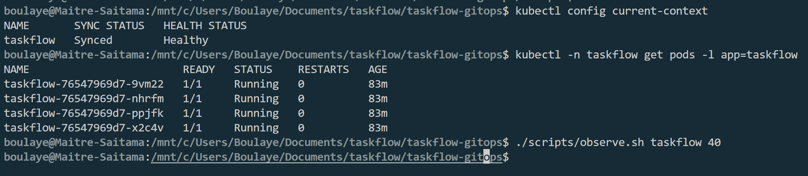

Sur `feat/bluegreen`, nous avons remplacé `deployment.yaml` par le Rollout de `exemples/bluegreen/` et ajouté `service-preview.yaml`. Le service de production a été conservé.

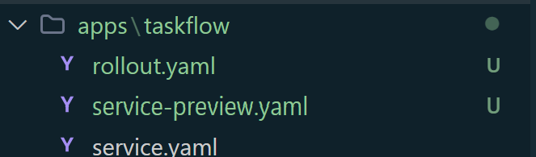

La stratégie utilise deux services et attend notre décision pour basculer :

```yaml
strategy:
  blueGreen:
    activeService: taskflow
    previewService: taskflow-preview
    autoPromotionEnabled: false
    scaleDownDelaySeconds: 30
```

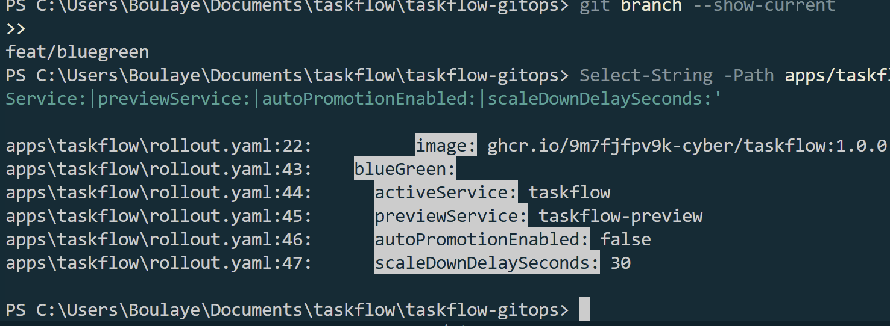

Après la fusion de la [PR #5](https://github.com/Darkbd11/taskflow-gitops/pull/5), Argo CD a appliqué le Rollout et supprimé l’ancien Deployment avec `prune`. La production répondait toujours en `1.0.0`.

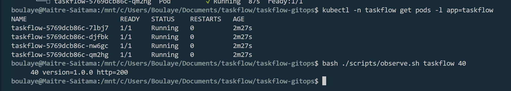

### Tester 1.1.0 sur le preview, puis basculer

La [PR #6](https://github.com/Darkbd11/taskflow-gitops/pull/6), préparée sur `feat/bluegreen-1.1.0`, a changé uniquement l’image du Rollout en `1.1.0`.

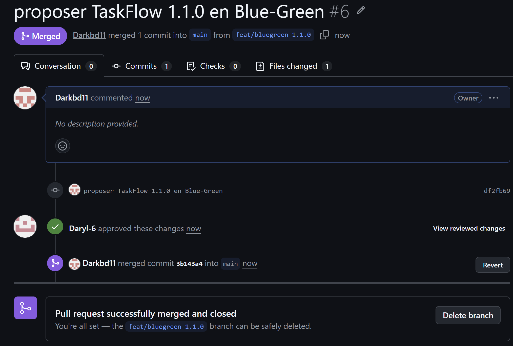

Avant la promotion, nous avons interrogé les deux services :

```bash
bash ./scripts/observe.sh taskflow 40
bash ./scripts/observe.sh taskflow-preview 40
```

La production a donné 40 réponses en `1.0.0`, HTTP 200. Le preview a donné 40 réponses en `1.1.0`, HTTP 200. La nouvelle version était donc accessible pour les tests sans avoir remplacé celle de production.

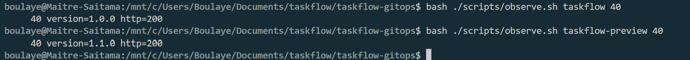

Le Rollout était en pause et nous avons compté **huit pods prêts**, répartis en deux groupes de quatre.

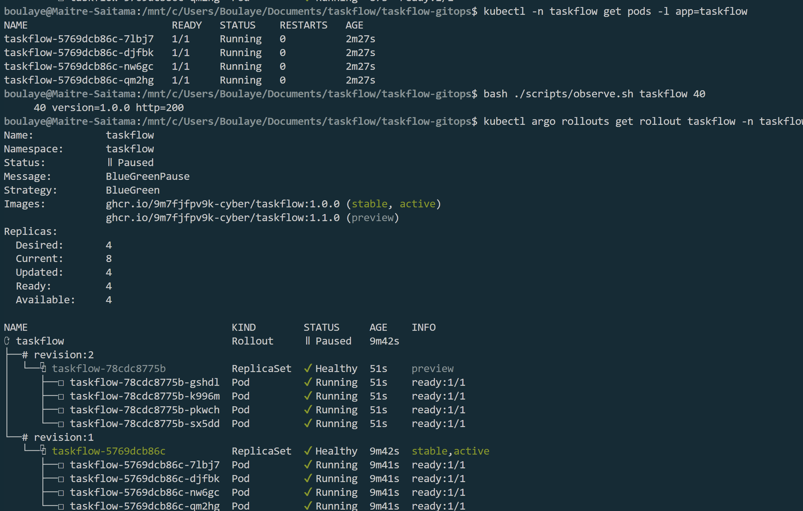

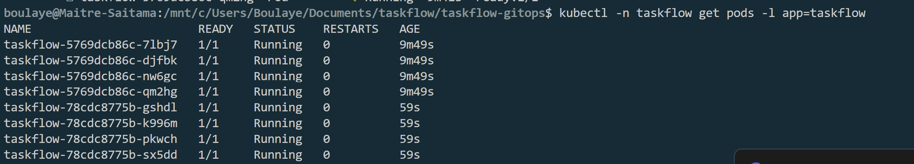

Nous avons ensuite autorisé la bascule :

```bash
kubectl argo rollouts promote taskflow -n taskflow
bash ./scripts/observe.sh taskflow 40
```

Les 40 réponses de production étaient désormais en `1.1.0`, HTTP 200.

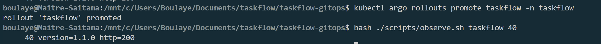

Le délai de conservation des anciens pods était fixé à 30 secondes. Lors du contrôle suivant, l’ancien ReplicaSet était `ScaledDown` et il restait quatre pods prêts en `1.1.0`.

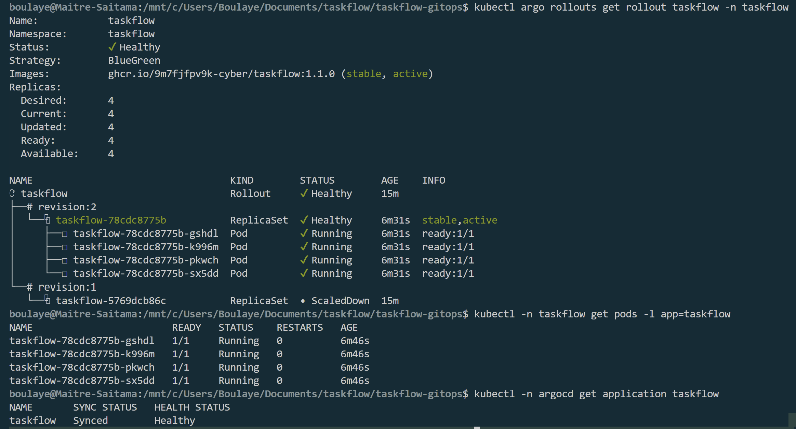

Le coût du Blue-Green était visible : il a fallu faire tourner les deux groupes complets pendant la transition.

### Passer au Canary en conservant 1.1.0

Sur `feat/canary`, nous avons repris le Rollout de `exemples/canary/`. L’exemple contient `1.0.0` ; nous avons remis `1.1.0` pour conserver la version déjà servie. Le service preview a été supprimé et `taskflow` a été conservé.

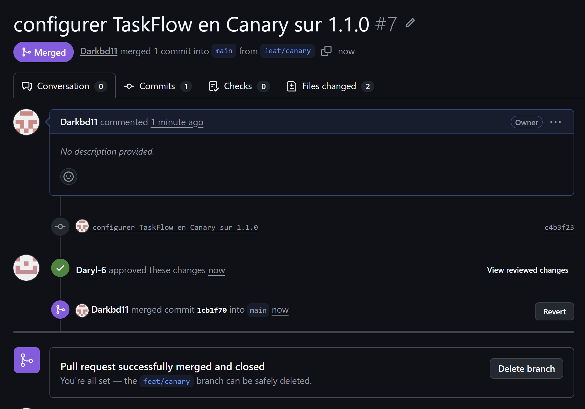

La configuration prévoit :

```yaml
strategy:
  canary:
    steps:
      - setWeight: 25
      - pause: {}
      - setWeight: 50
      - pause:
          duration: 60s
      - setWeight: 75
      - pause:
          duration: 30s
```

La pause à 25 % est manuelle. Une fois débloquée, les pauses à 50 % et 75 % durent respectivement 60 et 30 secondes, puis la progression atteint 100 %.

Après la fusion de la [PR #7](https://github.com/Darkbd11/taskflow-gitops/pull/7), la stratégie était Canary, mais la version restait `1.1.0`. Les quatre pods étaient prêts et les 40 réponses étaient en HTTP 200.

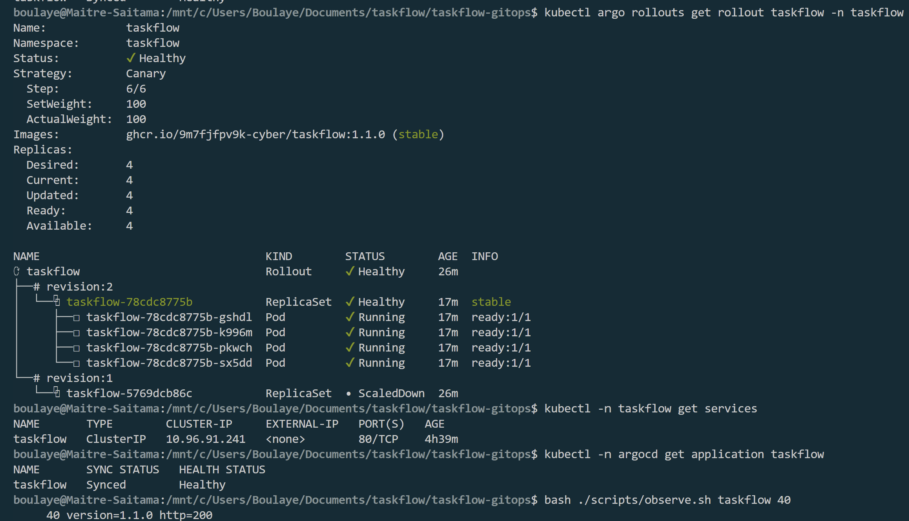

### Déployer 2.0.0 par paliers

La [PR #8](https://github.com/Darkbd11/taskflow-gitops/pull/8), préparée sur `feat/canary-2.0.0`, a proposé l’image `2.0.0`.

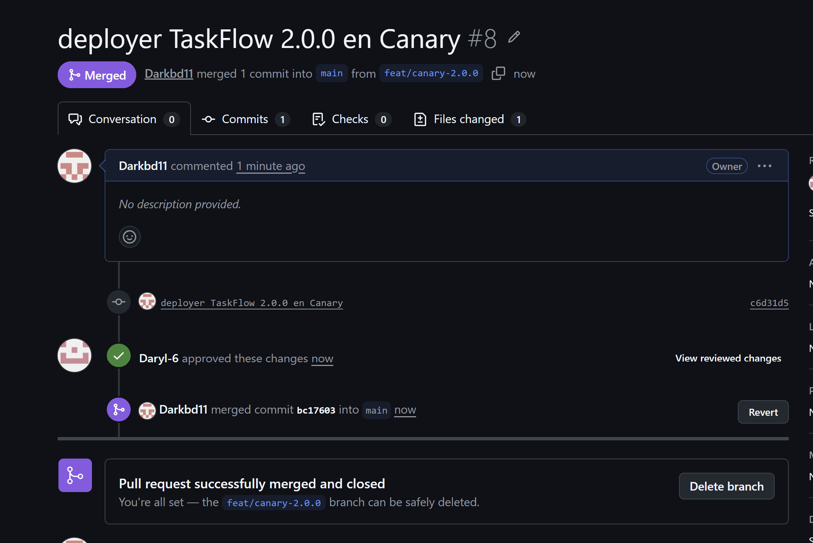

Nous avons suivi le déploiement avec :

```bash
kubectl argo rollouts get rollout taskflow -n taskflow --watch
```

Au premier palier, le Rollout était en pause à 25 %, avec trois pods en `1.1.0` et un en `2.0.0`.

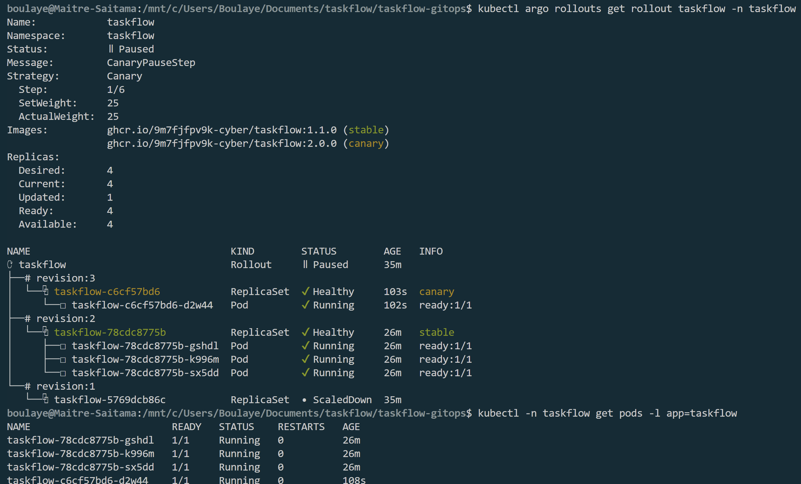

L’observation de 100 requêtes a donné :

```text
74 version=1.1.0 http=200
26 version=2.0.0 http=200
```

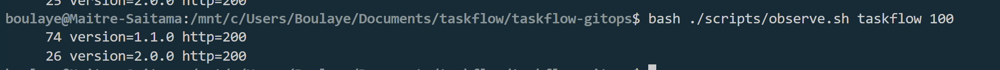

Nous n’avons pas de routeur de trafic dédié dans ce lab : la répartition repose sur le nombre de pods. Sur 100 requêtes, les 26 réponses de la nouvelle version ne sont donc pas une anomalie par rapport au poids de 25 %.

Pour continuer :

```bash
kubectl argo rollouts promote taskflow -n taskflow
```

Les étapes suivantes étaient temporisées. Nous avons conservé les preuves à 25 % et à 100 %, mais pas les mesures intermédiaires à 50 % et 75 %.

À la fin, le service a renvoyé 100 réponses en `2.0.0`, HTTP 200.

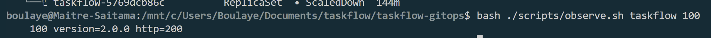

Le Rollout était `Healthy`, à l’étape `6/6`, avec quatre pods prêts et `2.0.0` stable. Argo CD était `Synced / Healthy`.

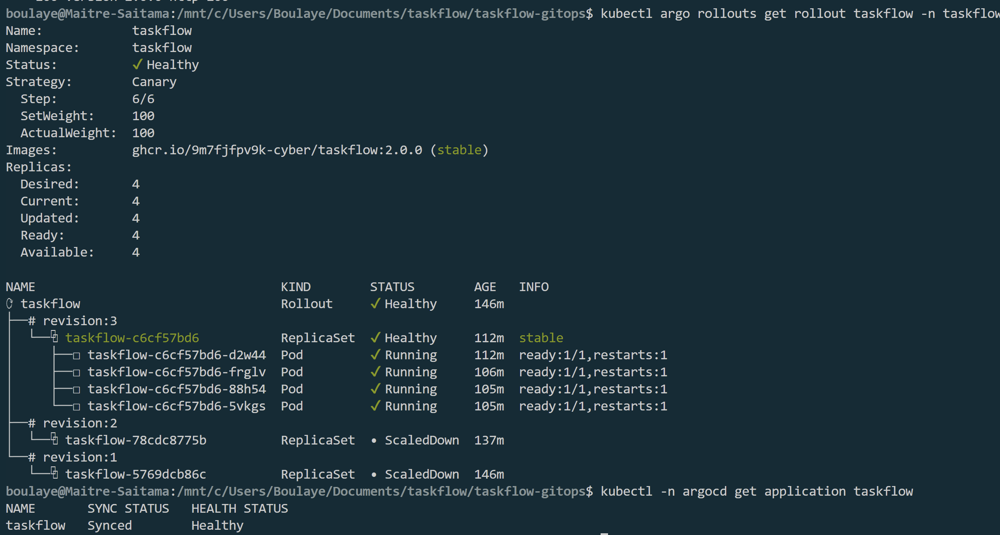

Après une extinction du PC, l’API du cluster local refusait les connexions. Nous avons redémarré l’environnement Docker, puis refait ces vérifications avant de poursuivre sur le cluster existant.

### Tester 2.1.0 : des pods prêts, mais des erreurs

Nous avons proposé `2.1.0` avec la [PR #9](https://github.com/Darkbd11/taskflow-gitops/pull/9), depuis `feat/canary-2.1.0`.

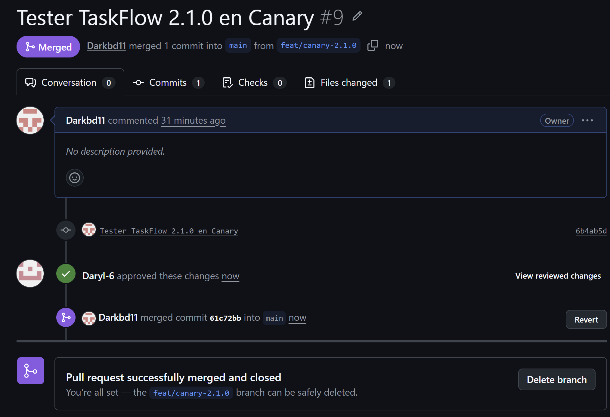

À 25 %, les trois pods stables en `2.0.0` et le pod Canary en `2.1.0` étaient tous prêts. Le ReplicaSet Canary apparaissait `Healthy`.

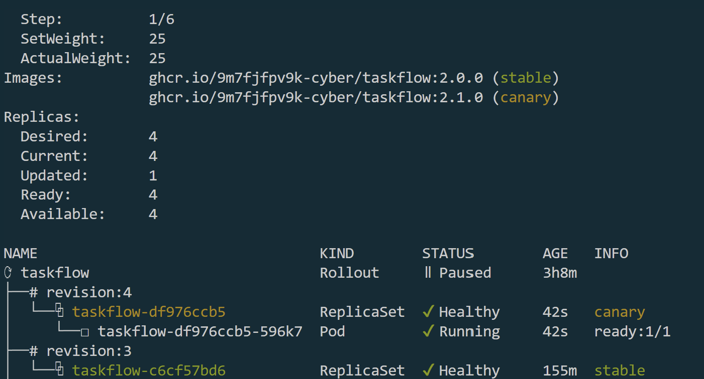

Pourtant, le test suivant a montré un problème :

```bash
bash ./scripts/observe.sh taskflow 100
```

| Réponse | Nombre |
| --- | --- |
| `version=2.0.0 http=200` | 76 |
| `version=2.1.0 http=200` | 14 |
| `version=aucune http=500` | 10 |

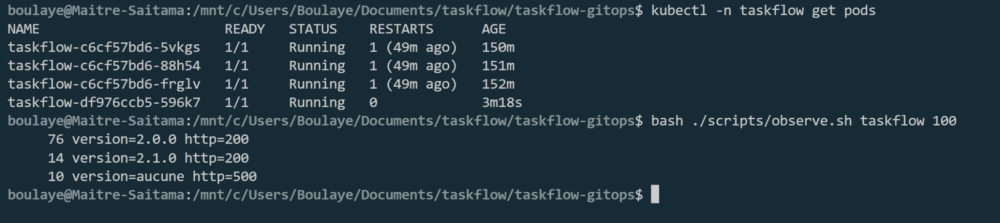

Nous avons donc observé **10 % d’erreurs sur cet échantillon**. `version=aucune` signifie que le script n’a pas trouvé le champ de version dans la réponse.

C’est le point que je retiens de ce test : un pod prêt ne garantit pas que toutes les requêtes utilisateur réussissent. Ici, les probes appellent `/health`, alors que notre script appelle `/`. Nous avons utilisé les réponses HTTP pour décider de ne pas promouvoir la version.

### Abandonner le déploiement et remettre Git en cohérence

Nous avons lancé :

```bash
kubectl argo rollouts abort taskflow -n taskflow
```

Puis contrôlé le Rollout, Argo CD et le service :

```bash
kubectl argo rollouts get rollout taskflow -n taskflow
kubectl -n argocd get application taskflow
bash ./scripts/observe.sh taskflow 100
```

Le Canary a été réduit à zéro. Les quatre pods stables en `2.0.0` étaient prêts et les 100 requêtes ont répondu en `2.0.0`, HTTP 200.

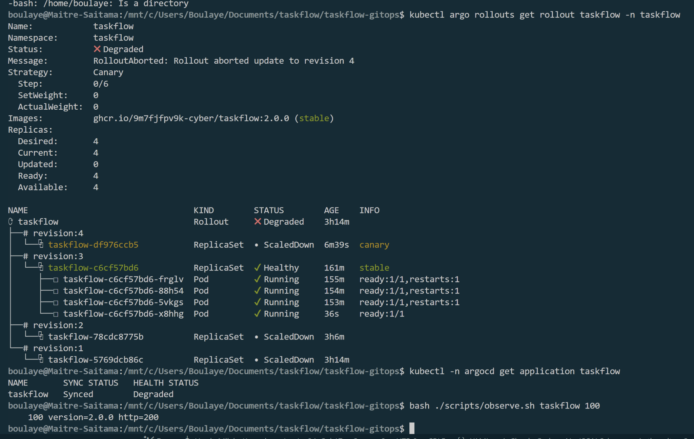

Le Rollout restait `Degraded`, avec le message `RolloutAborted`. Argo CD affichait `Synced / Degraded`, et Git demandait toujours `2.1.0`.

L’`abort` avait donc rétabli le service, mais il n’avait pas changé la version déclarée dans le dépôt. Nous avons utilisé **Revert** sur la PR #9. Daryl a approuvé la [PR #10](https://github.com/Darkbd11/taskflow-gitops/pull/10), puis nous l’avons fusionnée pour remettre l’image en `2.0.0`.


Après synchronisation, le Rollout était `Healthy` et Argo CD `Synced / Healthy`. Le test a confirmé 100 réponses en `2.0.0`, HTTP 200.

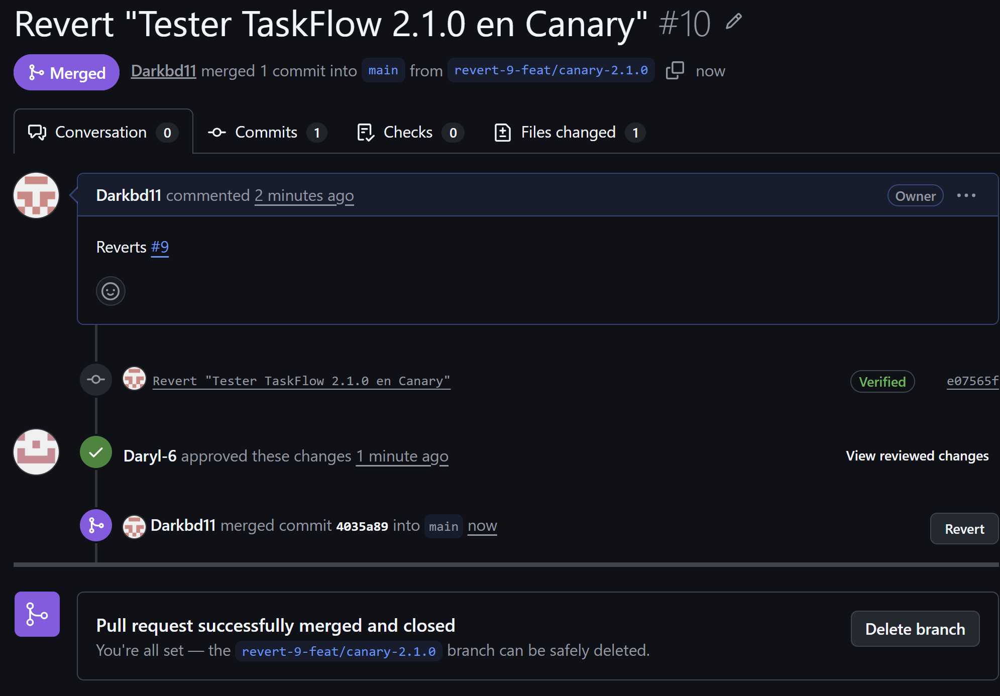

### Que montrent le Rollout, Argo CD et Git après un abort ?

Dans notre cas, le **Rollout** indiquait que le déploiement avait été abandonné : `Degraded`, `RolloutAborted`, Canary à zéro. La version stable continuait à servir les requêtes.

**Argo CD** était `Synced / Degraded`. Le manifeste appliqué correspondait toujours à Git, d’où `Synced`. Son état de santé signalait l’abandon du déploiement. Être synchronisé ne signifie donc pas que la nouvelle version a été déployée avec succès.

**Git** contenait encore `2.1.0`. La suite a été de remettre `2.0.0` par une PR de revert, puis de contrôler les statuts et les réponses. Les deux actions ont eu des rôles différents : l’`abort` a arrêté la progression ; le revert a corrigé la configuration voulue.

## Journal des déploiements

Pour le matin, les preuves conservées sont la fusion de la configuration Argo CD, les observations en `1.0.0` puis `2.0.0`, la commande de dérive et la préparation du revert. Les limites de ces preuves sont précisées dans les étapes correspondantes.

Pour l’après-midi, les heures ci-dessous sont les **heures de fusion des PR, en heure de Paris**. Elles viennent de GitHub. Nous n’avons pas relevé l’heure exacte de chaque observation ou promotion.

| Fusion | Action | Résultat documenté |
| --- | --- | --- |
| 16:02:45 | [PR #5](https://github.com/Darkbd11/taskflow-gitops/pull/5) · `ce5533c` · Blue-Green | Production conservée en `1.0.0` |
| 16:10:50 | [PR #6](https://github.com/Darkbd11/taskflow-gitops/pull/6) · `3b143a4` · Image `1.1.0` | Production en `1.0.0`, preview en `1.1.0`, huit pods prêts avant promotion |
| Après la PR #6 | Promotion Blue-Green | 40 réponses en `1.1.0`, HTTP 200 ; retour à quatre pods |
| 16:27:57 | [PR #7](https://github.com/Darkbd11/taskflow-gitops/pull/7) · `1cb1f70` · Configuration Canary | `1.1.0` stable, état sain |
| 16:34:46 | [PR #8](https://github.com/Darkbd11/taskflow-gitops/pull/8) · `bc17603` · Image `2.0.0` | À 25 % : 74 réponses en `1.1.0`, 26 en `2.0.0`, toutes HTTP 200 |
| Après la PR #8 | Promotion Canary | À 100 % : `2.0.0` stable et 100 réponses HTTP 200 |
| 19:09:38 | [PR #9](https://github.com/Darkbd11/taskflow-gitops/pull/9) · `61c72bb` · Image `2.1.0` | À 25 % : pods prêts, mais 10 erreurs HTTP 500 sur 100 requêtes |
| Avant la PR #10 | Abandon du Canary | Service en `2.0.0`, HTTP 200 ; Rollout et santé Argo CD `Degraded` ; Git encore en `2.1.0` |
| 19:23:59 | [PR #10](https://github.com/Darkbd11/taskflow-gitops/pull/10) · `4035a89` · Revert vers `2.0.0` | Rollout `Healthy`, Argo CD `Synced / Healthy`, 100 réponses HTTP 200 |

## Notre choix pour TaskFlow : Canary

Pour TaskFlow, nous choisirions **le Canary**, à condition de surveiller les erreurs avant de poursuivre le déploiement. Le test de `2.1.0` nous donne un exemple concret : le problème est apparu alors que la nouvelle version ne représentait qu’un pod sur quatre. Nous avons pu arrêter la progression avant de l’étendre.

Cela a quand même un coût pour les utilisateurs : certaines requêtes ont échoué dès le premier palier. Le Canary limite l’exposition, mais ne supprime pas le risque.

Le Blue-Green permet de tester sur le preview avant de toucher à la production. Il est aussi intéressant pour une bascule rapide et un retour vers l’ancien groupe tant que celui-ci est encore disponible. Dans notre configuration, les anciens pods sont conservés 30 secondes après la promotion. En revanche, une erreur non détectée sur le preview peut toucher tout le trafic une fois la bascule faite.

Côté ressources, nous avons observé huit pods en Blue-Green pendant la coexistence des versions, contre quatre au palier Canary de 25 %. Ce sont les nombres constatés dans ce lab, pas une règle générale : un Canary peut créer des pods supplémentaires pendant les transitions. Nous n’avons pas calculé de coût financier.

Le choix du Canary repose donc surtout sur la possibilité de tester progressivement avec le trafic réel et d’arrêter tôt une version défectueuse. Il faut toutefois une observation adaptée : les probes seules n’ont pas suffi dans notre test. Les décisions de promotion et d’abandon sont restées manuelles ; nous n’avons pas mis en place de détection ni de rollback automatique.


