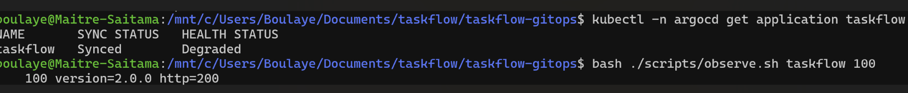
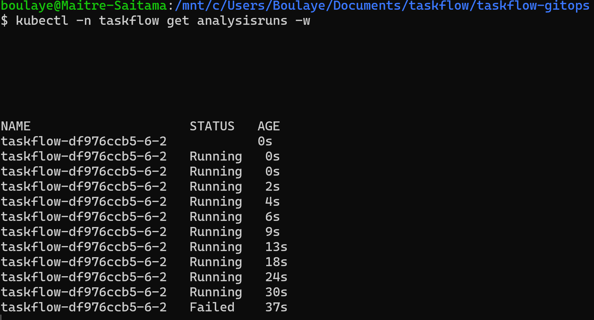
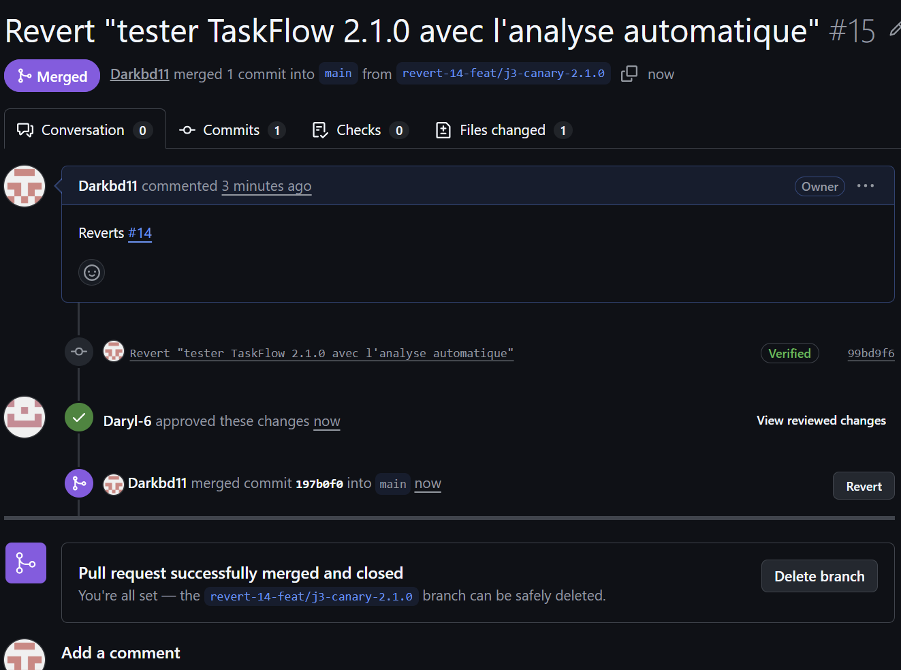
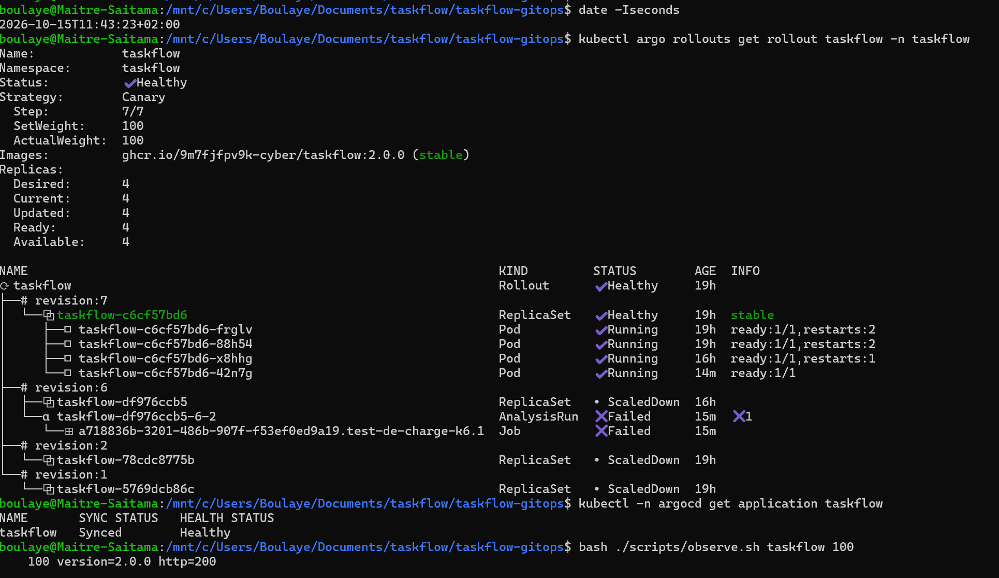
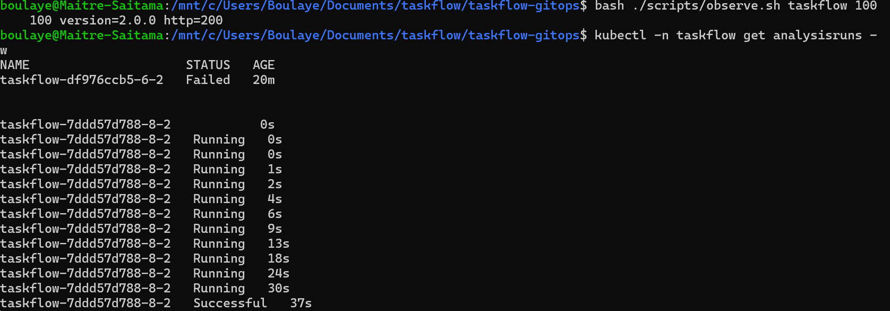
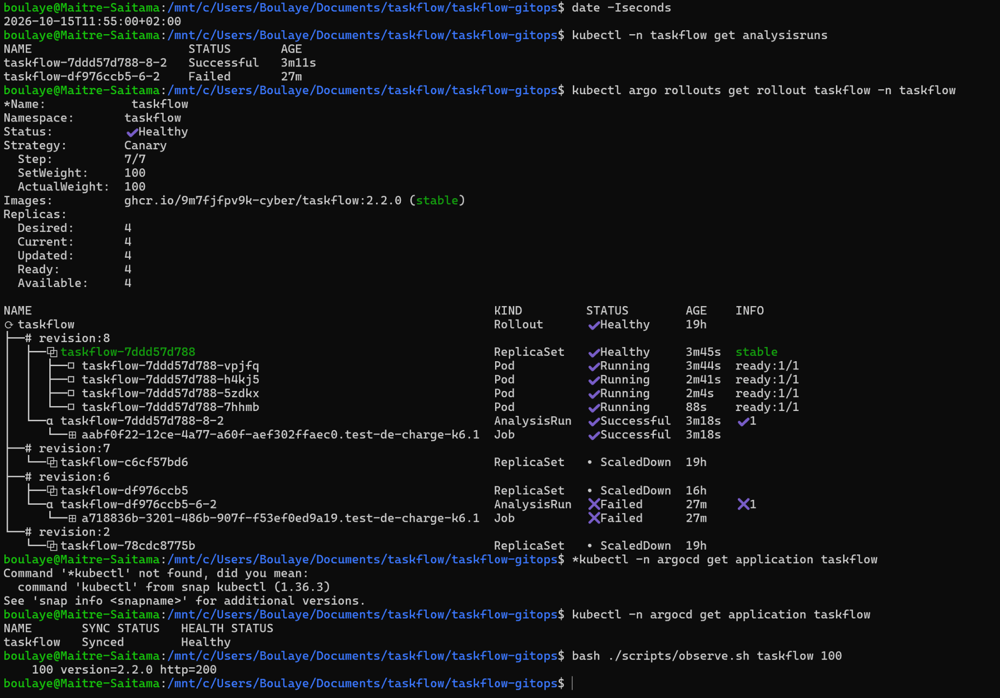

# Postmortem — TaskFlow 2.1.0 arrêté pendant le Canary

**15 octobre 2026 · Lab J3 matin · Boulaye DOUCOURE et Darry KANYEP**

## Résumé

Nous avons déployé TaskFlow `2.1.0` pour vérifier que le test de charge pouvait arrêter seul une version défectueuse. Au palier de 25 %, Argo Rollouts a lancé k6 sur `taskflow-canary`, qui ciblait uniquement le nouveau pod.

Le test a mesuré **90 requêtes en échec sur 299, soit 30,10 %**, et un **p95 HTTP de 313,22 ms**. Les deux seuils ont été dépassés : moins de 2 % d’erreurs et un p95 inférieur à 250 ms. L’analyse a échoué et le Rollout a abandonné la révision 6 sans commande manuelle d’`abort`.

Après stabilisation, le service répondait de nouveau en `2.0.0`. Nous avons ensuite fusionné une PR de revert pour remettre aussi cette version dans Git. Enfin, `2.2.0` a réussi le même contrôle et atteint 100 %.

| Champ | Valeur |
| --- | --- |
| Environnement | Cluster kind local `cicd`, namespace `taskflow` |
| Version concernée | `ghcr.io/9m7fjfpv9k-cyber/taskflow:2.1.0` |
| Changement à l’origine | [PR #14](https://github.com/Darkbd11/taskflow-gitops/pull/14), commit de fusion `bfb6e1b` |
| Composant concerné | API TaskFlow ; parcours `GET /tasks` testé par k6 |
| Détection | Analyse `taskflow-df976ccb5-6-2`, métrique `test-de-charge-k6` |
| Protection du service | Abandon automatique par Argo Rollouts ; retour au groupe stable en `2.0.0` |
| Correction de Git | [PR #15](https://github.com/Darkbd11/taskflow-gitops/pull/15), revert vers `2.0.0` |
| Version validée ensuite | `2.2.0`, [PR #16](https://github.com/Darkbd11/taskflow-gitops/pull/16) |
| Durée de l’analyse en échec | **37 secondes**, de 11:28:13 à 11:28:50 |
| Durée exacte d’exposition | Non mesurée ; les 37 secondes ne représentent pas toute la fenêtre d’exposition |

## Impact observé

Le déploiement est resté au premier palier : un pod en `2.1.0` et trois pods stables en `2.0.0`, soit 25 % des pods de l’application sur la nouvelle version.

Les 30,10 % d’erreurs ont été mesurés **sur la nouvelle version seule**, via `taskflow-canary`. Nous n’avons pas mesuré le taux global d’erreurs du service principal pendant cette fenêtre. Sans routeur de trafic dédié, le poids de 25 % repose sur la proportion de pods ; il ne garantit pas une répartition exacte de chaque série de requêtes.

Après l’abandon, l’observation du service principal a donné `100 version=2.0.0 http=200`. Le défaut n’a donc pas été étendu aux paliers suivants.



## Chronologie

Toutes les heures sont en **heure de Paris, UTC+02:00**. Les heures de fusion viennent de GitHub ; le début et la fin des analyses viennent des champs `startedAt` et `completedAt` de l’export Kubernetes.

| Heure | Événement et preuve |
| --- | --- |
| 11:12:42 | Fusion de la [PR #13](https://github.com/Darkbd11/taskflow-gitops/pull/13) : ajout du test automatique, image maintenue en `2.0.0`. |
| Avant la PR #14 | Référence k6 sur `2.0.0` : 728 requêtes, 0 % d’erreurs, p95 de 8,32 ms. |
| 11:26:31 | Fusion de la PR #14 : image `2.1.0`. |
| Avant 11:28:13 | Le nouveau pod devient prêt ; le sélecteur de `taskflow-canary` passe au hash `df976ccb5`. Les événements ne fournissent ici que des âges relatifs. |
| 11:28:13 | Début de l’analyse `taskflow-df976ccb5-6-2`. |
| 11:28:44 | k6 signale le franchissement des seuils `http_req_duration` et `http_req_failed` dans ses logs. |
| 11:28:50 | L’AnalysisRun se termine en `Failed` : une mesure en échec, pour une limite d’échec à zéro. |
| Après l’échec | Les événements montrent `RolloutAborted`, le Canary réduit de 1 à 0 et le groupe stable remonté de 3 à 4 pods. |
| Après stabilisation | 100 réponses en `2.0.0`, HTTP 200 ; Argo CD `Synced / Degraded`. |
| 11:41:43 | Fusion de la PR #15 : Git demande de nouveau `2.0.0`. |
| À partir de 11:43:23 | Vérification après revert : Rollout `Healthy`, Argo CD `Synced / Healthy`, 100 réponses en `2.0.0`, HTTP 200. |
| 11:50:09 | Fusion de la PR #16 : image `2.2.0`. |
| 11:52:02 | Début de l’analyse `taskflow-7ddd57d788-8-2`. |
| 11:52:39 | Analyse `Successful`, après 37 secondes. |
| Après l’analyse réussie | Les événements montrent la poursuite des étapes et la montée du nouveau ReplicaSet. |
| À partir de 11:55:00 | Contrôle final : `2.2.0` stable à 100 %, quatre pods prêts, Argo CD `Synced / Healthy`, 100 réponses HTTP 200. |

La fusion de la PR #14 et l’échec de l’analyse sont séparés de **2 min 19 s**. Ce délai comprend la prise en compte du changement et le démarrage du Canary ; il ne constitue pas une mesure de la durée pendant laquelle les utilisateurs ont subi le défaut.

## Cause racine

Le défaut est volontaire dans le scénario du cours. Le [workflow de publication des images](https://github.com/9m7fjfpv9k-cyber/cicd-fil-rouge/blob/main/.github/workflows/publish-images.yml) définit, pour `2.1.0`, `FAILURE_RATE=0.3` et `LATENCY_MS=300`. Le [Dockerfile](https://github.com/9m7fjfpv9k-cyber/cicd-fil-rouge/blob/main/Dockerfile) transmet ces paramètres à l’environnement de l’application.

Dans [`app/main.py`](https://github.com/9m7fjfpv9k-cyber/cicd-fil-rouge/blob/main/app/main.py), le middleware `inject_faults` ajoute cette latence et peut renvoyer un HTTP 500 pour les routes autres que `/health`. Cela correspond au comportement mesuré sur `/tasks` : environ 300 ms par requête et environ 30 % d’échecs.

La cause identifiée est donc **la configuration d’injection de pannes de la version 2.1.0**. L’échec du Job k6 est la conséquence du dépassement des seuils, pas un problème de lancement du test : les logs montrent un scénario terminé avec 299 requêtes.

### Pourquoi les probes étaient-elles vertes ?

Les probes de readiness et de liveness interrogent `/health`. Cette route est explicitement exclue de l’injection de pannes. Le pod pouvait donc devenir prêt, alors que le parcours utilisateur `/tasks` était lent et renvoyait des erreurs.

Les événements contiennent aussi des refus de connexion de probes au démarrage de certains pods. Nous les distinguons du défaut testé : pendant l’analyse, le pod Canary était prêt, et les erreurs applicatives ainsi que la latence sont documentées par les mesures k6 et la configuration de l’image.

### Comment la chaîne a-t-elle arrêté la version ?

Au palier de 25 %, le Rollout attend 20 secondes puis déclenche l’AnalysisTemplate `robustesse-k6`. Le Job exécute 30 secondes de charge avec cinq utilisateurs virtuels sur `http://taskflow-canary/tasks`.

k6 sort en erreur lorsque ses seuils échouent. Le Job passe en échec et Argo Rollouts classe la métrique puis l’AnalysisRun en `Failed`. Le message du Rollout indique :

```text
Metric "test-de-charge-k6" assessed Failed due to failed (1) > failureLimit (0)
```

Le contrôleur abandonne alors le déploiement. Aucune promotion ni commande manuelle d’abandon n’a été utilisée pendant ce scénario.

## Chaîne de preuves

| Question | Preuve conservée |
| --- | --- |
| Quelle révision a été arrêtée ? | [Sortie du Rollout](j3-matin-08-rollout-2.1.0.txt) : révision 6, `RolloutAborted`, Canary à zéro, `2.0.0` stable. |
| Quelle analyse a échoué ? | [Détail de l’AnalysisRun](j3-matin-08-analysisrun-2.1.0.txt) et [export des deux analyses](j3-matin-15-analysisruns.yaml). |
| Qu’a mesuré k6 ? | [Logs du Job en échec](j3-matin-08-logs-k6-2.1.0.txt) : 90 échecs sur 299 et p95 de 313,22 ms. |
| Dans quel ordre les actions ont-elles eu lieu ? | [Événements Kubernetes](j3-matin-15-evenements-final.txt), timestamps des analyses et historique des PR. |



Les captures montrent les statuts ; les fichiers texte conservent les noms des ressources et les messages pour pouvoir relire l’enquête. L’export des événements utilise `LAST SEEN`, avec des âges relatifs : nous ne lui attribuons pas d’heures absolues à la seconde près.

## Résolution et validation

L’abandon a protégé le service, mais Git demandait encore `2.1.0`. Argo CD affichait donc `Synced / Degraded` : le manifeste correspondait à Git, alors que le déploiement demandé avait été abandonné.

La PR #15 a remis `2.0.0` dans Git. Après synchronisation, le Rollout et Argo CD sont revenus à un état sain.





La version `2.2.0` a ensuite suivi le même mécanisme d’analyse, avec des paramètres de panne remis à zéro dans le workflow de publication du cours.

| Version | Cible du test | Requêtes | Échecs | p95 HTTP | Résultat |
| --- | --- | ---: | ---: | ---: | --- |
| 2.0.0 | Service principal, test manuel de référence | 728 | 0 — 0 % | 8,32 ms | Seuils respectés |
| 2.1.0 | Service Canary, analyse automatique | 299 | 90 — 30,10 % | 313,22 ms | Échec et abandon automatique |
| 2.2.0 | Service Canary, analyse automatique | 725 | 0 — 0 % | 13,85 ms | Succès puis progression à 100 % |

Les trois tests utilisent cinq utilisateurs virtuels pendant 30 secondes. Le test de référence et les analyses ne visent toutefois pas le même nombre de pods. Ce sont des contrôles des seuils du lab, pas une comparaison de capacité à grande échelle.





## Ce qui a fonctionné

Le service Canary a isolé la nouvelle version pour le test. Les mesures n’ont pas été diluées par les réponses des pods stables. L’analyse a empêché la poursuite d’une version défectueuse, puis autorisé la progression de `2.2.0`.

Le revert par PR a conservé la trace de la correction et de sa relecture par le binôme. Nous avons pu rapprocher les PR, les révisions, les AnalysisRun et les Jobs pour expliquer la décision prise par la chaîne.

## Actions correctives et suites

Les actions réalisées correspondent au lab. Les deux dernières lignes sont des propositions pour améliorer la chaîne ; les responsables et échéances proposés restent à valider avec le binôme.

| Action | Responsable | Date ou échéance | État |
| --- | --- | --- | --- |
| Ajouter le contrôle k6 pendant le Canary | Boulaye ; relecture Daryl | 15/10/2026 | Réalisé, PR #13 |
| Annuler la référence à `2.1.0` dans Git | Boulaye ; relecture Daryl | 15/10/2026 | Réalisé, PR #15 |
| Valider une version saine avec le même contrôle | Boulaye ; relecture Daryl | 15/10/2026 | Réalisé, PR #16 et analyse réussie |
| Automatiser l’archivage des logs et événements avec leurs timestamps absolus | Boulaye | 16/10/2026 | Proposition |
| Figer la version ou le digest de l’image k6 à la place de `latest` | Daryl | 16/10/2026 | Proposition |

Ce lab montre la limite des seuls contrôles de santé. Le pod pouvait répondre à `/health` tout en offrant un mauvais service sur `/tasks`. Le test de charge a apporté le critère nécessaire pour décider de poursuivre ou d’arrêter le déploiement.

